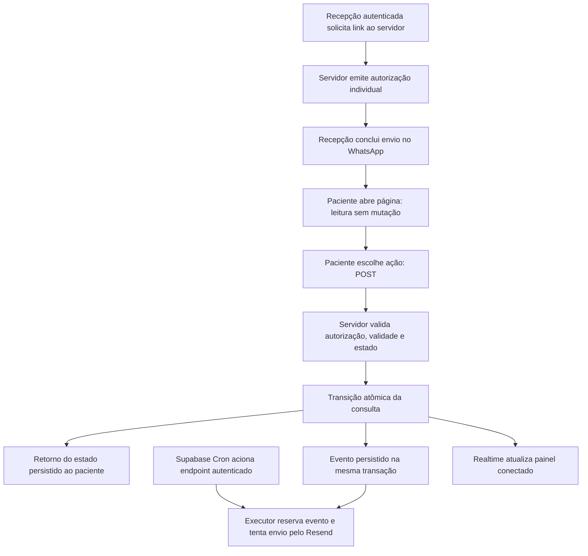

# Sistema de Notificações Clínicas — Dra. Michelle Tiago

* **Autoria:** ij
* **Data:** 2026-11-09
* **Situação:** Design revisado; implementação e ativação não realizadas
* **Elaboração:** [Rascunho aprovado](../../design_draft.md)

## Visão geral

O consultório precisa comunicar lembretes aos pacientes e informar à dentista e à recepção quando uma consulta for confirmada ou cancelada. A proposta combina envio humano pelo WhatsApp, alertas por e-mail e atualização do painel de atendimento.

A recepção abre uma mensagem preparada a partir do painel e conclui o envio no WhatsApp. O paciente acessa um link individual e confirma ou cancela por uma ação explícita na página. Depois que a alteração da consulta for registrada, o sistema tenta enviar um e-mail à Dra. Michelle, em `dramichellebarbosatiago@gmail.com`, e atualizar o painel aberto da recepção via Supabase Realtime.

O objetivo é usar os canais já adotados pela equipe e evitar a operação de um robô de WhatsApp ou a instalação de um novo aplicativo. O e-mail pode gerar um alerta no celular conforme as configurações do aplicativo e do aparelho. A aceitação do envio pelo provedor não comprova entrega à caixa de entrada, exibição na tela de bloqueio ou leitura pela dentista.

**Requisito esclarecido pelo autor:** receber o aviso de confirmação no celular mesmo quando não estiver diante do painel. O envio precisa ser executado no servidor e não pode depender de uma aba aberta, de acesso posterior ao painel ou de um computador da recepção ligado. O mesmo desenho de notificação deve atender aos cancelamentos previstos no escopo.

Esta seção descreve o comportamento pretendido. A inspeção estática do código está registrada no plano técnico; ela não demonstra o funcionamento do ambiente publicado.

## O problema

Confirmações e cancelamentos afetam a organização da agenda. Quando a equipe só descobre uma mudança ao consultar manualmente o painel ou conversar com o paciente, pode demorar a liberar um horário ou preparar o atendimento.

A dentista também precisa acompanhar essas mudanças fora do painel. O alerta deve começar pelo estado da consulta e permitir identificar o horário com pouca leitura. O conteúdo exibido fora do sistema, especialmente na tela de bloqueio, exige uma decisão sobre quais dados do paciente podem aparecer.

Falhas no canal de comunicação não podem desfazer uma alteração já registrada na agenda. Também é necessário distinguir uma nova mudança de uma repetição da mesma ação, para evitar alertas duplicados.

## Objetivos

1. **Facilitar os lembretes assistidos:** permitir que a recepção abra, pelo painel, uma mensagem com o link individual da consulta e conclua o envio humano no WhatsApp. Abrir a mensagem não deve ser tratado como prova de envio.
2. **Informar confirmações e cancelamentos:** tentar enviar um e-mail à dentista após uma mudança efetiva e persistida para confirmado ou cancelado, com assunto iniciado por `[CONFIRMADA]` ou `[CANCELADA]`. A composição restante do assunto será definida no plano técnico.
3. **Manter a agenda como referência:** apresentar ao paciente o resultado persistido da sua ação mesmo quando o envio do e-mail falhar. A falha do canal de alerta deve ser identificável para a equipe responsável pelo sistema.
4. **Evitar efeitos por prévias e repetições:** a abertura do link por uma prévia automática não deve alterar a consulta; a repetição de uma ação já concluída não deve produzir uma nova mudança nem um novo alerta para o mesmo evento.
5. **Informar a recepção no painel aberto:** refletir as mudanças de estado e oferecer avisos visuais e sonoros, sujeitos à conexão e às permissões do navegador. Reconexão e recuperação de mudanças perdidas serão detalhadas no plano técnico.
6. **Facilitar o contato de retorno:** oferecer no e-mail um acesso ao WhatsApp do paciente quando houver telefone válido, permitindo que a dentista inicie o contato.
7. **Conter o custo operacional:** buscar operação dentro das cotas gratuitas disponíveis, validando limites e requisitos antes da ativação. Custo zero, ausência de bloqueios e entrega instantânea não são garantias deste projeto.

## Fora do escopo

* Robôs ou gateways autônomos de WhatsApp, incluindo Z-API, Twilio e Evolution API.
* Campanhas de marketing, newsletters e cobranças em massa.
* Notificações Web Push e instalação de PWA como condição para receber alertas.
* Atendimento por inteligência artificial ou negociação automática de horários.
* Novo fluxo de solicitação de reagendamento: o exemplo `[REAGENDAR]` do documento de origem não integra o escopo inicial de confirmação e cancelamento.

## Verificações pendentes antes da ativação

* Comparar schema, funções e permissões do banco de destino com as fontes locais; verificar os papéis efetivos da equipe.
* Confirmar extensões e versão de Postgres compatíveis com o intervalo de 30 segundos, limites do deployment e cotas/custos dos serviços.
* Validar remetente/domínio Resend e conta, monitor e regra de alertas Sentry.
* Executar a implementação e sua verificação, incluindo concorrência, recuperação de falhas, ausência de duplicações dentro do contrato e início de envio na meta definida.
* Comprovar o recebimento no aparelho configurado com o painel fechado e dados fictícios, em teste autorizado.

## Jornadas críticas de uso

### Paciente confirma com o painel fechado

* **Dado:** consulta futura pendente, link válido e todos os painéis fechados.
* **Quando:** o paciente confirma por ação explícita na página.
* **Então:** consulta e evento são gravados juntos; o paciente recebe o resultado persistido, e o processamento de servidor inicia a tentativa de e-mail dentro da meta de 60 segundos em operação normal. Recebimento e exibição no celular são verificados separadamente.

### Provedor de e-mail falha temporariamente

* **Dado:** consulta confirmada com evento persistido e uma falha transitória no transporte.
* **Quando:** o executor registra a falha e chega o horário da nova tentativa.
* **Então:** o evento é retomado com a mesma chave e conteúdo, sem nova confirmação do paciente; o estado da consulta permanece confirmado. A falha definitiva fica identificável e gera aviso técnico conforme a regra do monitor.

### Paciente cancela ou repete uma ação

* **Dado:** link válido e consulta em estado compatível com a ação solicitada.
* **Quando:** o paciente cancela ou repete uma ação já concluída.
* **Então:** um cancelamento efetivo libera o horário e registra seu evento; uma repetição retorna o estado consolidado sem novo evento. Uma confirmação pendente de envio pode ser superada pelo cancelamento conforme o contrato de processamento.

### Equipe reagenda e substitui o link

* **Dado:** profissional autorizado altera data ou horário da consulta.
* **Quando:** a alteração é persistida e a equipe emite um novo link.
* **Então:** as credenciais anteriores são revogadas; elas não permitem ler dados ou alterar a consulta. A equipe distribui a nova credencial e registra o envio humano separadamente da abertura do WhatsApp.

## Plano técnico

### Evidências e limites da inspeção

Inspeção estática dos arquivos locais em 2026-11-09. Os dois serviços de grafo consultados não tinham índice utilizável deste projeto; a verificação foi feita diretamente nas fontes. Não foram executadas requisições aos serviços, alterações no banco, testes com pacientes ou envios de mensagens. O código local não comprova quais migrações estão aplicadas no ambiente publicado.

| Componente | Comportamento observado | Consequência para o plano |
| --- | --- | --- |
| [cancellation.ts](../../src/lib/cancellation.ts) | A validação decodifica base64url e aceita um segredo não vazio sem conferir assinatura ou correspondência com um segredo armazenado. Também aceita o formato legado. | O token atual não comprova autorização. É necessário substituir emissão e validação antes de ativar o fluxo proposto. |
| [reminders.ts](../../src/lib/reminders.ts) | Gera tokens no navegador com o sufixo fixo `clinica`. | A emissão de credenciais precisa passar ao servidor; o navegador não deve fabricar permissões. |
| [Página de confirmação](../../src/routes/confirmar/$token.tsx) | A leitura usa a função GET; confirmar e cancelar usam funções POST. Para reagendar, a página fabrica um token de cancelamento a partir do ID. | Preservar a ausência de mutação na leitura e substituir a fabricação de token por uma autorização definida no servidor. Não basta assinar apenas o link inicial. |
| [cancellation.ts](../../src/lib/cancellation.ts) | Confirmação já realizada retorna sucesso; cancelamento já realizado retorna erro. Consulta e alteração são etapas separadas, com fallback de RPC para atualização por ID. | Tornar repetições consistentes e garantir transições atômicas, inclusive sob concorrência. Não usar fallback irrestrito que contorne uma rejeição de negócio. |
| [cancellation.ts](../../src/lib/cancellation.ts) | Os disparos de confirmação e cancelamento são comentários TODO. | Conectar o novo serviço somente após comprovar uma mudança persistida. |
| [notify-server.ts](../../src/lib/notify-server.ts) | O agendamento inicial já contém chamadas a FormSubmit, Resend opcional, Formspree e webhook opcional. | Esse fluxo é distinto dos alertas de mudança de status. Reutilizar ou substituir canais existentes exige análise própria para evitar duplicação. |
| [painel.tsx](../../src/routes/_authenticated/painel.tsx) | A inscrição Realtime invalida consultas e mostra toasts. O clique que abre o WhatsApp também marca o lembrete como enviado. | Recarregar estado após reconexão e separar abertura de mensagem de confirmação humana de envio. A inspeção não encontrou implementação de áudio nos fontes pesquisados. |

### Fluxo compartilhado pela proposta

A transação da consulta cria o evento; o Supabase Cron aciona posteriormente o executor, que consulta e reserva esse evento. O envio é independente da requisição do paciente. Um `try...catch` isolado não substitui a persistência nem garante continuidade após o encerramento da requisição.

### Autorização dos links — opção B aprovada

O autor aprovou o uso de token aleatório com registro no banco, armazenando apenas seu hash. O servidor emite a credencial e valida sua existência, ações permitidas, expiração e revogação antes de revelar dados ou alterar uma consulta. Apenas acrescentar um prazo ao formato atual não impede manipulação. Links antigos não podem continuar autorizando acesso por meio da validação permissiva atual.

| Opção | Mecanismo | Custo e limitações | Condição de falha |
| --- | --- | --- | --- |
| A — Token assinado | O servidor assina os campos da autorização, incluindo consulta, ações permitidas e expiração, e confere a assinatura a cada uso. | Evita uma tabela de tokens; exige gestão da chave. Revogação individual e invalidação por reagendamento requerem mecanismo adicional. | Chave comprometida permite fabricar autorizações; campos não cobertos pela assinatura não são confiáveis. |
| B — Token aleatório com registro | O servidor gera um valor imprevisível e armazena seu hash associado à consulta, às ações permitidas, à expiração e à revogação. | Facilita revogar ou substituir links; exige alteração de schema e consulta ao banco para validar. | Indisponibilidade do banco impede validação; armazenamento do token em texto ou vazamento do link compromete sua proteção. |

**Decisão registrada:** opção B. A opção A fica documentada como alternativa não selecionada por exigir mecanismo adicional para revogação individual.

#### Emissão e armazenamento

Uma função de servidor autorizada para a equipe gera um token com fonte criptográfica de aleatoriedade. O registro associa um hash criptográfico do token à consulta, às ações permitidas, ao instante de criação, à expiração e à eventual revogação. Uma restrição de unicidade protege o hash. O valor original só é retornado para compor o link; não é armazenado na tabela nem nos logs.

A tabela de autorizações não terá leitura ou escrita direta por usuários anônimos. O acesso da equipe e dos serviços será limitado à clínica e às operações autorizadas. Saber o ID da consulta não autoriza emitir uma credencial: o servidor deve conferir a permissão de quem solicita. O agendamento público não emite credenciais para os avisos auxiliares de novo agendamento. A equipe autenticada solicita a emissão no servidor e distribui o link ao paciente pelo WhatsApp assistido.

Como só o hash é armazenado, um link não pode ser reconstruído do registro. Se for necessário obter outro link, o servidor emite nova credencial. Conforme a política aprovada adiante, a substituição explícita revoga os links anteriores da consulta e informa essa consequência à equipe.

#### Validação e uso

O servidor aplica limites de tamanho e formato ao token recebido, calcula seu hash e busca a autorização correspondente. Só permite a leitura mínima ou a ação prevista quando a autorização existe, não expirou, não foi revogada e está vinculada à consulta correta. Ausência de autorização válida e indisponibilidade do banco não permitem continuar a operação. As respostas públicas não devem revelar dados da consulta em caso de token inválido.

A conferência final de autorização e a alteração do estado devem ocorrer na mesma transação, evitando que uma revogação concorrente seja ignorada entre a consulta e a gravação. A leitura GET não consome nem revoga a credencial. Repetições de POST com autorização ainda válida devem respeitar a idempotência descrita abaixo.

O link inicial que hoje permite confirmar ou solicitar cancelamento exige um conjunto de ações expressamente concedido pelo servidor, ou credenciais distintas emitidas por ele. A interface não pode transformar uma credencial em outra alterando o propósito no navegador. O link principal concede confirmação e cancelamento no servidor; a política de revogação por substituição e reagendamento está definida adiante.

O prazo de 48 horas após a consulta vem do documento de origem; a janela em que confirmar ou cancelar é permitido deve ser tratada separadamente da validade da credencial. O token continua sendo uma credencial de acesso: quem obtiver o link poderá exercer as ações concedidas enquanto ele for válido. Não incluí-lo em telemetria, logs ou avisos auxiliares de terceiros. A distribuição deliberada ao paciente pelo WhatsApp assistido é permitida; o conteúdo dos avisos de novo agendamento fica sem links públicos de ação e conserva somente o acesso autenticado ao painel. Definir política de referenciador restritiva nas páginas públicas.

#### Migração

A implementação exigirá uma migração versionada para o registro de autorizações, a emissão no servidor e a substituição dos geradores e validadores atuais. O formato legado permissivo será recusado; a clínica precisará emitir e enviar novos links para as consultas afetadas. Essa transição deve ser coordenada para não distribuir links novos antes de o respectivo validador estar disponível.

### Transições de estado e repetição

O servidor deve distinguir mudança efetiva, ação repetida e transição proibida. A verificação do estado e sua atualização precisam ser atômicas. Confirmar novamente uma consulta confirmada e cancelar novamente uma consulta cancelada devem retornar o estado consolidado sem novo evento de envio. As regras para consultas concluídas, passadas e pedidos concorrentes devem ser explicitadas e testadas antes da implementação.

As chamadas atuais às RPCs não demonstram seu contrato transacional no banco publicado. A busca pelos nomes `confirm_appointment_by_id` e `cancel_appointment_by_id` nos arquivos locais de `supabase/` não encontrou suas definições. É necessário inspecionar o contrato real ou definir migração versionada antes de depender delas. Não é possível presumir sua existência, permissões ou comportamento.

As comparações atuais constroem data e hora sem fuso explícito. A implementação deve usar o horário da clínica de forma consistente para validade e regras de atendimento, independentemente do fuso do servidor.

### Serviço de e-mail e garantia de envio

O documento de origem propõe um módulo exclusivo de servidor em `src/lib/email.server.ts`, com chamada HTTP ao Resend e templates HTML e texto. O módulo precisa validar configuração, destinatário e telefone, escapar conteúdo interpolado e tratar timeout e respostas HTTP malsucedidas. Chaves de serviço não devem chegar ao navegador; tokens de acesso não devem ser registrados em logs. O assunto começa pelo estado, seguido do nome completo, data e horário, conforme a opção de conteúdo aprovada abaixo.

O autor esclareceu que precisa receber a confirmação fora do painel e aprovou o envio com recuperação de falhas: opção B abaixo, com evento persistido e reprocessamento. A operação do executor está definida nesta seção e detalhada no plano de implementação.

| Opção | Mecanismo | Custo e limitações | Condição de falha |
| --- | --- | --- | --- |
| A — Tentativa limitada | Após confirmar a transação, o servidor aguarda uma tentativa de envio com timeout e tratamento de erro, depois responde ao paciente. | Menor escopo; a espera é limitada, mas existe. Uma falha é registrada sem recuperação automática. | O alerta pode ser perdido se o processo parar depois da gravação, se o provedor falhar ou se houver timeout. |
| B — Evento persistido e reprocessamento | A mesma transação grava a alteração da consulta e um evento pendente; um executor envia o e-mail e registra tentativas e resultado. | Permite recuperar falhas; exige tabela de eventos, executor agendado, controle de concorrência e acompanhamento de eventos que esgotaram tentativas. A latência depende da execução. | O envio atrasa ou para se o executor não rodar; uma resposta incerta do provedor pode causar duplicação sem tratamento específico. |

A tentativa única fica registrada como alternativa não selecionada, com risco de perda do aviso. A opção B aprovada precisa registrar o evento na mesma transação da mudança da consulta, sem depender de o navegador continuar aberto. Um executor independente busca eventos pendentes, envia e registra resultados. Falhas transitórias geram novas tentativas limitadas; falhas permanentes ou tentativas esgotadas permanecem identificáveis para intervenção. A identidade do evento deve distinguir uma mudança efetiva de recliques.

Repetições por concorrência e repetição de envio após resposta incerta do provedor seguem os contratos de reserva e idempotência descritos adiante. O executor, seu intervalo, limites de tentativas e acompanhamento de falhas fazem parte do desenho aprovado. Esses mecanismos não comprovam que o e-mail foi lido ou exibido no celular.

**Critério de aceite fora do painel:** com todas as abas do sistema fechadas, realizar uma confirmação controlada e verificar separadamente a gravação na agenda, a criação e processamento do evento, o recebimento do e-mail e a exibição do alerta no aparelho configurado. Simular uma falha temporária do provedor e verificar recuperação sem nova ação do paciente nem reabertura do painel. Usar dados de teste e envio previamente autorizado.

#### Prazo da primeira tentativa — 1 minuto aprovado

O autor definiu a meta de iniciar a primeira tentativa de envio em até 60 segundos após a confirmação persistida, em operação normal. Aplicar a mesma meta aos cancelamentos. Medir do instante de gravação da transição até o início da requisição ao provedor, sem confundir essa medida com o recebimento do e-mail ou com sua exibição no celular.

Um agendamento a cada minuto, sozinho, não demonstra cumprimento da meta: a espera até a próxima execução pode consumir quase todo o prazo, antes de latência de disparo, inicialização e processamento. A estratégia escolhida deve reservar margem para essas etapas e ser validada com eventos criados em diferentes momentos do ciclo. Atrasos por indisponibilidade precisam ficar registrados e ser recuperáveis; o prazo não é uma garantia absoluta de entrega.

#### Execução independente do painel — Supabase selecionado

O [vercel.json](../../vercel.json) local contém um cron diário de lembretes, e o [vite.config.ts](../../vite.config.ts) seleciona o destino Vercel. Esse cron diário não atende à meta de um minuto. A configuração local não comprova o plano contratado nem o estado do deployment.

| Opção | Mecanismo | Custo e limitações | Condição de falha |
| --- | --- | --- | --- |
| A — Agendamento pelo Supabase | Supabase Cron, com `pg_cron` e `pg_net`, chama um endpoint autenticado do próprio aplicativo para processar eventos. A lógica de envio permanece no repositório do aplicativo. | Exige habilitar e configurar as extensões, proteger o segredo de chamada e verificar cotas. Não exige mover o envio para uma Edge Function. Intervalo e versão do Postgres precisam ser verificados. | Se o banco, o agendador ou o endpoint estiver indisponível, os eventos aguardam recuperação. |
| B — Agendamento pela Vercel | Cron da Vercel chama um endpoint autenticado do aplicativo que processa os mesmos eventos persistidos. | Mantém agendamento e aplicação no mesmo provedor; cron a cada minuto requer plano compatível. Pode envolver custo. Não confirma, por si, a meta de 60 segundos. | Falhas no agendador ou na aplicação atrasam os eventos; a frequência disponível no plano pode inviabilizar o requisito. |

**Decisão registrada:** opção A, Supabase Cron acionando o endpoint do aplicativo, seguindo a orientação do autor de adotar a opção recomendada. Essa escolha aproveita o banco existente e mantém o serviço de e-mail no aplicativo. O segredo de chamada fica no mecanismo de segredos do banco e na configuração de servidor, sem chave Resend dentro do SQL de agendamento. O endpoint rejeita chamadas sem autorização, não é armazenado em cache e reserva eventos atomicamente para impedir processamento concorrente do mesmo item.

Documentação consultada em 2026-11-09: [Supabase Cron quickstart](https://supabase.com/docs/guides/cron/quickstart), [pg_net](https://supabase.com/docs/guides/database/extensions/pg_net) e [limites de Cron Jobs da Vercel](https://vercel.com/docs/schedules/cron-jobs/usage-and-pricing). O Supabase documenta chamadas HTTP agendadas e intervalos em segundos em versões compatíveis; a Vercel documenta cron diário no Hobby e por minuto no Pro/Enterprise. Disponibilidade, plano e custo do ambiente da clínica ainda não foram verificados.

#### Parâmetros operacionais aprovados

Estes parâmetros foram aprovados com a seção de plano técnico. São decisões do desenho; ainda não representam configuração aplicada nem comportamento validado em produção.

* **Frequência:** acionar o processador a cada 30 segundos, sujeito à versão e às extensões disponíveis no Supabase. Esse intervalo deixa margem para iniciar o envio dentro da meta de 60 segundos. A ativação depende de comprovar a meta em testes, inclusive sob carga. Se o ambiente não suportar a frequência necessária, revisar o desenho com o autor em vez de ampliar silenciosamente o prazo.
* **Execução:** o cron chama o endpoint a cada 30 segundos, inclusive com fila vazia. A mesma execução consulta a saúde da fila e emite check-ins ao Sentry; o detector externo sinaliza a ausência dessas execuções. Essa simplificação aumenta as invocações ociosas, cujo consumo deve ser verificado. O endpoint processa lotes limitados; o tamanho será dimensionado pelos limites reais da função e do provedor. Cada evento reservado recebe uma concessão temporária de processamento, com identificador da reserva e vencimento, permitindo retomada após interrupção sem liberar trabalho ainda em execução.
* **Tentativas:** primeira tentativa assim que o executor encontrar o evento; em falhas transitórias, novas tentativas após 1, 2, 5 e 15 minutos contados da falha anterior. Respeitar um prazo de espera maior indicado pelo provedor. Após cinco tentativas totais, manter o evento em falha para intervenção. Falhas permanentes não entram em repetição automática indiscriminada.
* **Resultado:** marcar como aceito pelo provedor somente após resposta HTTP bem-sucedida e confirmação válida de aceitação. Timeout depois de uma possível aceitação é resultado incerto, não prova de falha de entrega. Usar a mesma identidade de evento nas novas tentativas e verificar o suporte e a janela de idempotência do provedor antes de fechar sua integração.
* **Acompanhamento:** manter contagem de tentativas, próximo horário, categoria do erro e identificador do provedor, sem registrar token, telefone, nome ou corpo do e-mail nos logs. O painel autenticado mostra pendências e falhas; a verificação de saúde acompanha o último processamento e a idade do evento pendente mais antigo. A ausência de execução não pode ser detectada apenas pelo próprio executor; o monitor independente será requisito de ativação, com aviso técnico por e-mail via Sentry definido no plano de implementação.

### Política de links e transições aprovada

O link principal permite visualizar os dados mínimos e confirmar ou cancelar a consulta à qual está vinculado. A autorização das duas ações é registrada no servidor; o navegador não emite outra credencial. O botão de reagendamento existente realiza um cancelamento autorizado e encaminha para escolher novo horário, sem um novo tipo de evento de notificação.

Proposta de ciclo de vida: a emissão de um link substituto pela equipe revoga os anteriores da mesma consulta e informa essa consequência na interface. Alterar data ou horário revoga os links anteriores e exige nova emissão. Confirmar não consome o link, permitindo ao paciente cancelar posteriormente enquanto a regra de atendimento permitir. O estado cancelado impede uma confirmação posterior pelo mesmo link. Consultas concluídas ou passadas não podem ser alteradas pelo paciente; a credencial pode permanecer válida para apresentar o estado consolidado até expirar. As decisões de leitura e repetição de ações continuam sujeitas à validade e à revogação da credencial.

As transições iniciais permitidas são `pending → confirmed`, `pending → cancelled` e `confirmed → cancelled`. Repetir a mesma ação no estado de destino retorna o estado consolidado, sem novo evento; isso não permite voltar de `cancelled` para `confirmed`. Um bloqueio da consulta serializa ações concorrentes, e a transação retorna se houve mudança real. Cada mudança real recebe identidade de evento única. Ao cancelar uma consulta já confirmada, gerar um evento de cancelamento distinto do evento anterior de confirmação.

Se um evento de confirmação ainda não tiver sido enviado quando ocorrer cancelamento, a proposta é marcá-lo como superado e priorizar o cancelamento, evitando um aviso de confirmação atrasado após a liberação do horário. Se a confirmação já tiver sido aceita pelo provedor, o cancelamento segue como mensagem separada; não é possível retirar o e-mail já enviado. Essa regra não garante ordenação na caixa de entrada.

Não será iniciado envio real para verificar o desenho. Remetente, domínio, cotas e configurações móveis serão validados na etapa de ativação autorizada.

### Conteúdo do aviso no celular — opção B aprovada

O autor escolheu nome completo no assunto. O formato aprovado é `[CONFIRMADA] Nome completo — DD/MM HH:mm` para confirmações e `[CANCELADA] Nome completo — DD/MM HH:mm` para cancelamentos. Data e horário representam a consulta no fuso da clínica. O corpo contém nome completo, data, horário e botão para o WhatsApp quando o telefone for válido; procedimento, prontuário e motivo de cancelamento ficam fora do e-mail. Os exemplos abaixo usam nome fictício e preservam a comparação considerada na decisão.

| Opção | Assunto de exemplo | Corpo do e-mail | Limitação |
| --- | --- | --- | --- |
| A — Primeiro nome no assunto | `[CONFIRMADA] Ana — 10/11 15h` | Nome completo, data, horário e botão para WhatsApp; sem procedimento, prontuário ou motivo de cancelamento. | Reduz a exposição no assunto, mas pacientes com o mesmo primeiro nome exigem abrir o e-mail para distinguir. |
| B — Nome completo no assunto | `[CONFIRMADA] Ana Silva — 10/11 15h` | Nome completo, data, horário e botão para WhatsApp; sem procedimento, prontuário ou motivo de cancelamento. | Facilita identificar a pessoa, mas expõe o nome completo e assuntos longos podem ser cortados. |

**Decisão registrada:** opção B. O aplicativo pode exibir o assunto e parte do corpo na prévia; nomes longos podem ser cortados conforme o aparelho. A escolha não garante que o texto inteiro apareça na tela e não altera a necessidade de validar a configuração de notificações no celular.

### Painel e páginas do paciente

Preservar os toasts e a atualização das consultas no painel, prevendo recarga do estado na reconexão. A distinção de eventos não pode depender cegamente de `payload.old.status`, cuja disponibilidade precisa ser verificada na configuração real do Realtime. A origem de uma mudança também não deve ser atribuída ao paciente apenas pelo novo status.

O som é uma funcionalidade a implementar e validar mediante interação da usuária e suporte do navegador. A abertura do WhatsApp não comprova envio: o painel deve representar a abertura ou solicitar registro humano separado, com texto coerente.

As páginas públicas devem confirmar o resultado da agenda sem declarar que a dentista recebeu ou leu a notificação. A prévia deve expor apenas os dados aprovados para quem possui um link válido. O botão existente de reagendamento deve ser acomodado na autorização escolhida, sem ampliar o escopo para um novo fluxo de notificações de reagendamento.

### Decisões registradas e revisão desta seção

**Aprovado:** token aleatório com registro no banco e armazenamento apenas do hash.

**Aprovado:** aviso independente do painel, com evento persistido e novas tentativas em falhas transitórias.

**Aprovado:** nome completo no assunto; corpo com nome completo, data, horário e acesso ao WhatsApp, sem informações clínicas ou motivo de cancelamento.

**Aprovado:** meta de iniciar o envio em até 1 minuto após a mudança persistida, em operação normal.

**Selecionado:** Supabase Cron aciona o processamento no aplicativo, seguindo a escolha do autor pela opção recomendada.

**Aprovado com o plano técnico:** parâmetros operacionais e política de links e transições descritos acima. As verificações de ambiente, monitor independente e contrato de idempotência do provedor continuam requisitos explícitos antes da ativação. A lista completa de arquivos e a verificação detalhada pertencem à etapa de implementação do documento.

## Alternativas consideradas — aprovadas

As três primeiras alternativas constam do documento de origem, relido nesta etapa. As demais registram escolhas feitas durante a construção do plano técnico. Os motivos abaixo não dependem das promessas de custo zero, ausência de bloqueios ou disponibilidade numérica do documento anterior, que não foram demonstradas.

### 1. Notificar a dentista por WhatsApp automatizado

* **Benefício:** receber o aviso em um canal de mensagens já conhecido, sem consultar o painel.
* **Limitação:** acrescenta contratação ou operação de uma integração de mensageria, com requisitos próprios de manutenção e uso. Serviços oficiais e integrações não oficiais não devem ser tratados como equivalentes em risco ou conformidade.
* **Motivo da rejeição pelo autor, conforme o documento de origem:** evitar um gateway autônomo no escopo inicial e manter os lembretes aos pacientes com envio humano assistido. A alternativa escolhida usa e-mail para o aviso à dentista.

### 2. Web Push por PWA

* **Benefício:** possibilita um canal de notificação próprio da aplicação, sem depender da caixa de e-mail.
* **Limitação:** exige um fluxo de habilitação no aparelho e operação de assinaturas e permissões de notificação, além da validação nos dispositivos usados pela clínica.
* **Motivo da rejeição pelo autor, conforme o documento de origem:** evitar uma nova etapa de instalação ou habilitação para a dentista no escopo inicial. O desenho usa o aplicativo de e-mail existente. A rejeição é por adequação ao fluxo pretendido; não pressupõe que Web Push seja tecnicamente inviável.

### 3. Webhook de mudança no banco enviando diretamente ao Resend

* **Benefício:** inicia o processamento a partir da mudança no banco e pode reduzir a dependência da requisição que fez a alteração.
* **Limitação:** o envio direto, isoladamente, não define recuperação, deduplicação, tratamento de erro ou política de conteúdo. Esses mecanismos ainda precisariam ser construídos. Uma integração configurada fora do repositório também precisa de versionamento e testes próprios.
* **Motivo da rejeição pelo autor, conforme o documento de origem:** manter a lógica de envio e seus testes no aplicativo. O plano aprovado usa evento persistido na transação e um endpoint do aplicativo para o envio, acionado pelo Supabase Cron. Usar o Supabase como agendador não equivale a entregar ao banco a composição e o envio direto do e-mail; a chave Resend permanece no serviço de servidor.

### 4. Token assinado sem registro individual

* **Benefício:** valida a autenticidade dos campos sem uma tabela de autorizações por link.
* **Limitação:** revogar um link específico ou invalidá-lo após reagendamento exige estado adicional ou outra estratégia explícita. Uma assinatura válida não resolve sozinha as regras de estado da consulta.
* **Motivo da rejeição pelo autor nesta elaboração:** foi aprovada a opção de token aleatório com apenas seu hash armazenado, para controlar expiração, substituição e revogação individual no banco já usado pelo sistema. O custo aceito é manter esse registro e consultá-lo a cada acesso.

### 5. Uma única tentativa de e-mail após a alteração da consulta

* **Benefício:** reduz componentes e permite executar uma tentativa imediata no próprio servidor da ação.
* **Limitação:** se a execução for interrompida depois da gravação, ou se o provedor falhar, não existe recuperação durável apenas com `try...catch`. Uma promessa de execução em segundo plano também não substitui persistência.
* **Motivo da rejeição pelo autor nesta elaboração:** a dentista precisa receber os avisos fora do painel, e foi aprovado registrar o evento junto da consulta e repetir tentativas em falhas transitórias. O mecanismo escolhido reduz perdas recuperáveis, sem garantir leitura ou entrega absoluta.

### 6. Cron da Vercel para o novo processador de notificações

* **Benefício:** concentra a configuração de agendamento na plataforma de hospedagem já indicada pelo projeto.
* **Limitação:** depende de um plano que permita a frequência necessária; o cron diário existente não atende à meta de iniciar o envio em um minuto. Mesmo uma execução por minuto não demonstra, sozinha, essa meta. A referência de limites foi registrada no plano técnico.
* **Motivo da rejeição pelo autor nesta elaboração:** foi selecionado Supabase Cron acionando o endpoint do aplicativo, aproveitando o banco existente e prevendo frequência de 30 segundos condicionada à verificação do ambiente. Essa escolha não autoriza contratação, alteração remota ou pressuposição de gratuidade. Não implica remover o cron diário de lembretes já existente.

### 7. Primeiro nome no assunto do e-mail

* **Benefício:** assunto menor e menor exposição de identificação na tela de bloqueio.
* **Limitação:** pacientes com o mesmo primeiro nome podem exigir abrir a mensagem para identificação.
* **Motivo da rejeição pelo autor nesta elaboração:** foi escolhido nome completo no assunto, seguido da data e do horário, para facilitar o reconhecimento fora do painel. O corte de assuntos longos e a exposição na prévia foram explicitados na escolha.

## Implementação detalhada

### Limites e condições de início

Esta seção especifica trabalho futuro. Nenhum arquivo de implementação, banco, configuração remota ou serviço foi alterado nesta elaboração. O modelo atual de `appointments` usa `appointment_date`, `appointment_time` e os estados `pending`, `confirmed`, `cancelled` e `completed`; o esquema ilustrativo de `SPEC.md` não deve substituir esse modelo. Não recriar a agenda nem ampliar o projeto para outros módulos.

Antes de aplicar migrações, comparar o banco de destino com as migrações locais, conferir as funções existentes e suas permissões, verificar as versões de Postgres/extensões e confirmar o destino publicado. Preparar e validar primeiro em ambiente isolado com dados fictícios. Divergências que mudem permissões, modelo ou infraestrutura exigem revisão do plano.

### Contratos de dados e operação

**Autorizações:** criar `appointment_link_tokens` com ID, `appointment_id`, hash SHA-256 único do token, ações permitidas, criação, expiração e revogação. Gerar 32 bytes aleatórios criptográficos no servidor e codificar para URL. O token original só existe na resposta de emissão e no link; o banco não o conserva. Usar o término programado da consulta, com sua duração e fuso da clínica, como referência para expiração 48 horas depois. A validade do link não permite confirmar ou cancelar uma consulta passada.

**Eventos:** criar `clinical_notification_events` com ID único, consulta, tipo de transição, origem, estado de processamento, criação, próxima tentativa, contagem de tentativas, reserva e vencimento, primeira tentativa de envio, aceitação do provedor, identificador de e-mail e categoria de erro. Estados: `pending`, `processing`, `accepted`, `failed`, `superseded` e `uncertain`. Associar a identidade do evento à transição real; não deduplicar apenas por ID da consulta, pois confirmar e cancelar são eventos distintos.

**Conteúdo estável:** o evento guarda somente os dados necessários ao aviso aprovado: nome, telefone para o botão, data e horário, sem notas clínicas. Antes da primeira tentativa, congelar remetente, destinatário, assunto, HTML, texto e versão do template no registro protegido do evento. Todas as tentativas reutilizam exatamente o mesmo conteúdo e a mesma chave de idempotência `clinical-status/<event-id>`. Mudança de configuração não altera uma mensagem cuja tentativa já começou.

**Contrato de transição:** uma função transacional recebe o hash da credencial, a ação e o motivo opcional do cancelamento, bloqueia a consulta e a autorização, revalida validade/revogação, aplica a regra de estado e grava o evento no mesmo commit. Retorna `changed`, estado consolidado e ID do evento quando houver. Se o evento não puder ser gravado, a mudança não é confirmada; falha posterior no envio não desfaz o commit. Consultas concluídas são imutáveis pelo paciente. Uma repetição sem mudança não cria evento.

**Permissões:** tabelas internas com RLS e sem acesso por `anon`; RPCs internas restritas ao serviço de servidor. A emissão pela equipe usa sessão verificada e a autorização administrativa já existente no projeto, sem conceder novos papéis implicitamente. A criação pública não emite nem transmite credenciais nos avisos de novo agendamento; a equipe distribui o link emitido no servidor pelo fluxo assistido. Nunca aceitar um ID arbitrário enviado pelo visitante como permissão para emitir um link. Não editar os arquivos de autenticação gerados para contornar a autorização.

**Alterações pela equipe:** revogar tokens no banco quando data ou horário mudar, inclusive por gravações que não passam pela interface atual. A transição pública registra origem `patient_link`; alterações internas continuam identificadas separadamente. O alerta por e-mail deste escopo decorre da ação do paciente. Se a equipe reagendar ou concluir antes do processamento de um evento pendente, marcar o aviso antigo como superado. Um evento cuja requisição já começou pode ter sido enviado; registrar esse limite em vez de prometer cancelamento do envio.

**Reservas e timeout:** o executor reserva até 10 eventos vencidos por chamada, com bloqueio que não espera registros já reservados. Processar com concorrência máxima de 2, timeout HTTP de 10 segundos por envio, orçamento de 20 segundos por execução e reserva de 90 segundos. Não reservar trabalho além do que pode iniciar nesse orçamento; liberar os não iniciados para a próxima rodada. Cada gravação de resultado exige o identificador da reserva vigente para que uma execução antiga não sobrescreva outra. Se os limites reais do deployment forem inferiores, não ativar até ajustar e validar esses parâmetros.

**Falhas e duplicações:** contar cada intenção de requisição persistida como tentativa, pois uma interrupção antes do transporte não é distinguível de um envio sem resposta; distinguir reserva sem envio de timeout depois de envio possível. Rede, timeout, limitação de taxa e falhas transitórias do provedor seguem os intervalos aprovados, respeitando `Retry-After`. Erro de configuração, autenticação ou payload não entra em repetição automática sem correção. Conservar resultado incerto e chave estável nas retomadas. A documentação do Resend informa retenção de idempotência por 24 horas; após essa janela, um resultado incerto vai para revisão, sem reenvio automático. Não existe garantia de entrega exatamente uma vez fora desse contrato.

**Superação:** antes de iniciar uma chamada ao provedor, conferir se o evento ainda representa a consulta atual. Cancelamento marca confirmações pendentes como superadas. Reservas que já iniciaram envio podem gerar confirmação e cancelamento em mensagens distintas; não presumir ordem de entrega.

**Proteção do endpoint:** `POST /api/internal/clinical-notifications/process` aceita apenas o segredo de processamento. Não existe um endpoint separado de saúde; as métricas do painel usam função autenticada e os check-ins são emitidos pelo próprio processador. Sem cache, sem redirecionar para login, sem dados pessoais nas respostas e sem segredos em URL. Comparação segura do segredo, validação de corpo e limite de tamanho. O processador não aceita destinatário, ID de consulta ou payload arbitrário do chamador. Na ausência de configuração válida, retorna erro sanitizado e não tenta outro canal por conta própria.

**Abuso dos links públicos:** impor tamanho/formato antes do banco e limite persistente por origem anonimizada e janela, sem usar apenas um mapa em memória do processo. Limite aprovado: 30 leituras ou 10 ações por minuto por origem; a origem deve vir de cabeçalhos confiáveis da hospedagem, não de qualquer cabeçalho enviado pelo visitante. O usuário recebe mensagem de espera, sem distinção que revele a existência de uma consulta. Uma falha do mecanismo de limite não autoriza a mutação.

**Monitor independente aprovado:** usar Sentry Crons, aproveitando o pacote `@sentry/node` já presente. O job de processamento chama o aplicativo a cada 30 segundos, inclusive sem eventos pendentes. A própria execução consulta o banco e informa ao Sentry se existe atraso maior que 60 segundos na primeira tentativa, falha definitiva ou ausência de progresso; o Sentry detecta a ausência dos próprios check-ins. Consolidar no máximo um par de check-ins por minuto, reservando no banco um identificador de ciclo compartilhado entre execuções concorrentes. Configurar no Sentry monitor por minuto, alerta de check-in ausente com tolerância de 2 minutos e execução acima de 1 minuto. O detector externo não depende de o processador detectar sua própria parada. Enviar avisos técnicos sanitizados para o e-mail da clínica por regra do Sentry, sem passar pelo Resend da fila. Verificar conta, permissão, plano e recebimento antes da ativação. A falta dessa configuração bloqueia a ativação; não trocar de fornecedor automaticamente.

**Retenção aprovada:** revogar links quando aplicável e remover registros expirados/revogados após 30 dias; conservar eventos terminais por 30 dias para diagnóstico e eliminar depois conteúdo e metadados do envio. Preservar consultas e registros clínicos existentes. Não apagar eventos ainda pendentes, incertos ou em revisão para cumprir essa limpeza; encaminhar os antigos para intervenção. A retenção no provedor de e-mail, monitor e caixa da destinatária é separada e deve ser documentada na ativação.

### Lista única de arquivos e mudanças

#### Contratos fechados após a revisão de prontidão

Os contratos abaixo resolvem as lacunas de schema, interfaces, limite de acesso, recuperação e avisos no painel. São especificações de implementação, não código aplicado.

**Schema:** usar o schema `public` para os objetos abaixo. Colunas são `NOT NULL` salvo indicação `nullable`; os horários de auditoria são `timestamptz` em UTC. `now` significa horário do banco. Criar as constraints indicadas na mesma migração do objeto.

| Objeto | Colunas e constraints |
| --- | --- |
| `appointments` existente | Acrescentar `cancellation_reason text nullable`, com limite de 500 caracteres. Não alterar nem sobrescrever `notes`. Não tentar extrair motivos históricos de notas livres. A nova transição de cancelamento grava somente `cancellation_reason`, estado e auditoria. |
| `appointment_link_tokens` | `id uuid PRIMARY KEY DEFAULT gen_random_uuid()`, `appointment_id uuid REFERENCES appointments(id) ON DELETE CASCADE`, `token_hash text UNIQUE CHECK` de 64 caracteres hexadecimais minúsculos, `allowed_actions text[] DEFAULT ARRAY['confirm','cancel']` não vazio e restrito a esses valores, `created_at timestamptz DEFAULT now()`, `expires_at timestamptz` posterior à criação, `revoked_at timestamptz nullable`. Índice por `appointment_id`. O hash é SHA-256 representado em hexadecimal; não há coluna para token original. |
| `clinical_notification_events` | `id uuid PRIMARY KEY DEFAULT gen_random_uuid()`, `appointment_id uuid nullable REFERENCES appointments(id) ON DELETE SET NULL`, `kind text CHECK` em `confirmed/cancelled`, `origin text DEFAULT 'patient_link' CHECK` nesse único valor, `status text DEFAULT 'pending' CHECK` nos seis estados definidos, `created_at timestamptz DEFAULT now()`, `next_attempt_at timestamptz nullable DEFAULT now()`, `attempt_count integer DEFAULT 0 CHECK` entre 0 e 5, `lease_id uuid nullable`, `lease_expires_at timestamptz nullable`, `attempt_lease_id uuid nullable`, `last_request_intent_at timestamptz nullable`, `first_request_intent_at timestamptz nullable`, `attempt_finished_at timestamptz nullable`, `accepted_at timestamptz nullable`, `provider_email_id text nullable`, `error_category text nullable`, `patient_name text`, `patient_phone text nullable`, `appointment_date date`, `appointment_time time`, `frozen_payload jsonb nullable`. Payload limitado às chaves `from/to/subject/html/text/template_version`; validar forma e tamanho no adaptador. Índice parcial por `next_attempt_at` para `pending/uncertain` com próximo horário não nulo, e por consulta/criação para superação e leitura de eventos. |
| `clinical_link_rate_buckets` | `source_hash text` hexadecimal HMAC-SHA256, `kind text CHECK` em `read/action`, `window_start timestamptz`, `request_count integer DEFAULT 0 CHECK >= 0`, `expires_at timestamptz`. Chave primária composta por `(source_hash,kind,window_start)`; índice por expiração. Não guardar endereço IP, token ou dados de paciente. |
| `clinical_notification_runtime` | Uma única linha com `id boolean PRIMARY KEY DEFAULT true CHECK (id)`, `cycle_slot timestamptz nullable`, `check_in_id uuid nullable`, `monitor_lease_id uuid nullable`, `monitor_lease_expires_at timestamptz nullable`, `last_cycle_completed_at timestamptz nullable`, `last_health_code text nullable CHECK` em `healthy/delayed/failed`. Inicializar essa linha na migração. É o estado compartilhado dos ciclos do monitor, não uma fila adicional. |

Em todas as tabelas novas, habilitar RLS sem políticas para `anon` ou acesso direto da equipe. Revogar execução pública das RPCs e conceder somente ao papel de serviço do servidor. As funções públicas de servidor que atendem à equipe verificam a sessão e `requireAdmin` antes de chamar essas RPCs. A única clínica deste projeto é o limite do desenho; expansão para outras clínicas exige novo isolamento e não é pressuposta.

**Ordem de bloqueio:** a emissão, revogação e transição bloqueiam primeiro `appointments`, depois os tokens vinculados e, por último, os eventos. Na transição, uma leitura inicial por hash localiza o ID, mas validade, revogação e estado são conferidos novamente após os bloqueios. O trigger de alteração de data/horário segue a mesma ordem. Nunca manter uma transação aberta enquanto chama Resend ou Sentry.

**RPCs internas:** implementar os nomes e argumentos abaixo; os wrappers validam forma e tamanho antes da chamada. `jsonb` de retorno segue os campos indicados, sem texto bruto de erro SQL. Falha de conexão ou erro inesperado é tratada como indisponibilidade pelo wrapper.

| RPC | Argumentos | Resultado e regra |
| --- | --- | --- |
| `clinical_issue_appointment_link` | `p_appointment_id uuid, p_token_hash text` | Retorna `{code,expires_at,snapshot}`; `snapshot` contém nome, telefone, data e hora persistidos para a mensagem da equipe. Bloqueia consulta futura elegível, revoga links anteriores e insere o novo hash com ações `confirm/cancel`. Códigos `ok/not_eligible`. Autorização administrativa acontece antes no wrapper; nunca disponibilizar essa RPC a `anon`. |
| `clinical_preview_appointment` | `p_token_hash text` | Retorna `{code,appointment}`. `appointment` contém apenas `patient_name,appointment_date,appointment_time,status,allowed_actions`; sem ID, serviço, telefone, motivo ou notas. Códigos `ok/invalid_link`. Token inexistente, revogado, expirado ou consulta removida usam o mesmo código. Sem mutação. |
| `clinical_apply_patient_action` | `p_token_hash text, p_action text, p_reason text nullable` | Retorna `{code,changed,status,event_id,appointment}`; `appointment` tem a projeção mínima de data/hora/nome. Códigos `ok/already_applied/invalid_link/action_not_allowed/appointment_past/transition_not_allowed`. Motivo é `trim`, vazio vira null, máximo 500 caracteres; só cancelamento aceita motivo. Cancelamento efetivo grava `appointments.cancellation_reason` e preserva `notes`. Repetição não altera o motivo já registrado. Transição e novo evento ficam no mesmo commit. |
| `clinical_claim_notification_events` | `p_limit integer DEFAULT 10` | Retorna array de eventos reservados com `id,lease_id,snapshot,attempt_count,frozen_payload`. Limitar entre 1 e 10. Recolher reservas vencidas conforme a máquina de recuperação, ignorar registros bloqueados, reservar elegíveis por `next_attempt_at,created_at,id` e aplicar lease de 90 segundos. Retornar array vazio é sucesso. |
| `clinical_begin_notification_attempt` | `p_event_id uuid,p_lease_id uuid,p_payload jsonb` | Retorna `{code,attempt_count,frozen_payload,idempotency_key}`. Códigos `ok/stale_lease/superseded/exhausted`. Confere consulta atual e orçamento de tentativas; congela o primeiro payload ou exige igualdade com o já congelado; incrementa a tentativa, associa `attempt_lease_id` à reserva atual e registra intenção imediatamente antes da requisição. Não envia HTTP no banco. |
| `clinical_finish_notification_attempt` | `p_event_id uuid,p_lease_id uuid,p_result text,p_provider_id text nullable,p_error_category text nullable,p_retry_after_seconds integer nullable` | Retorna `{code,status,next_attempt_at}`; códigos `ok/stale_lease`. `p_result` é `accepted/retryable/permanent/uncertain`; categorias pertencem à tabela de resultados abaixo. O banco calcula próximo horário e limpa lease. Uma reserva antiga não sobrescreve o resultado atual. |
| `clinical_release_unstarted_events` | `p_lease_ids uuid[]` | Libera apenas reservas cujo `attempt_lease_id` seja diferente da reserva atual ou nulo; volta a `pending` e agenda para agora, sem consumir tentativa. Resultado `{released_count}`. |
| `clinical_claim_monitor_cycle` | Sem argumentos | Calcula o minuto UTC no banco; retorna `{claimed,lease_id,check_in_id}`. Só reserva ciclo novo quando o anterior terminou ou sua lease de 90 segundos venceu. Gerar IDs no banco; várias instâncias não criam pares concorrentes para o mesmo minuto. |
| `clinical_finish_monitor_cycle` | `p_lease_id uuid,p_health_code text` | Registra conclusão e saúde se o lease ainda for atual; retorna `{updated}`. `last_cycle_completed_at` somente avança após o envio da conclusão do check-in; falha de comunicação não é registrada como monitor entregue. |
| `clinical_get_notification_status` | Sem argumentos | Retorna `{pending_count,failed_count,uncertain_count,oldest_unattempted_at,last_cycle_completed_at}` e os últimos 20 eventos com `id,status,created_at,attempt_count,error_category`. Sem payload, telefone ou hash. |
| `clinical_get_recent_patient_events` | Sem argumentos | Retorna até 100 eventos dos últimos 10 minutos, ordenados por `created_at DESC,id DESC`, com `id,appointment_id,kind,origin,created_at,patient_name,appointment_date,appointment_time`. É projeção de eventos, independente do resultado do transporte. Não incluir motivo, payload, telefone ou credencial. |

As respostas públicas das server functions usam `{success,data,error}`; `error` é null no sucesso e, no erro, contém `code,message,retryAfterSeconds` quando aplicável. `invalid_link` recebe mensagem única “Link inválido ou expirado”; `already_applied` é sucesso com `changed=false`; regras de estado recebem mensagens específicas sem detalhes do banco. Falha inesperada usa `temporarily_unavailable`. Os componentes precisam verificar `success` antes de exibir sucesso ou redirecionar; uma chamada HTTP concluída não basta. O endpoint interno retorna 401 para segredo ausente/incorreto, 405 para método não permitido, 503 para configuração/banco indisponível e 200 com contagens de processamento quando executa normalmente.

**Rate limit fechado:** usar janela fixa de 60 segundos, delimitada pelo relógio UTC do banco. Consumo separado para `read` (30) e `action` (10), pela chave HMAC-SHA256 do endereço de origem e tipo de operação. Implementar `clinical_consume_link_limit(p_source_hash text,p_kind text)` retornando `{allowed,retry_after_seconds}` com incremento atômico do bucket no minuto atual; atualizar/inserir sob a chave composta, sem leitura e gravação desprotegidas. Pedidos excedentes não alteram a consulta. Retenção do bucket: fim da janela mais 5 minutos; limpeza diária remove os expirados. A janela permite rajada de até dois limites ao redor da troca de minuto, comportamento aceito para este fluxo.

No deployment Vercel, aceitar somente `x-vercel-forwarded-for` como origem quando a aplicação estiver realmente atendida pela borda Vercel; validar uma única representação IPv4/IPv6 com `node:net`, sem lista de valores, porta ou conteúdo arbitrário. Normalizar espaços e caixa antes do HMAC. Não recorrer a cabeçalhos alternativos enviados pelo visitante. Ausência/formato inválido da origem ou falha de consumo produz `temporarily_unavailable` e não executa leitura da consulta nem ação. No teste local, injetar provedor de origem determinístico; não criar bypass de produção controlado pelo navegador. A ativação deve demonstrar que o deployment substitui o cabeçalho e não aceita acesso direto não confiável. Referência adicional: [cabeçalhos de requisição Vercel](https://vercel.com/docs/headers/request-headers).

Limite excedido retorna `rate_limited`, mensagem “Muitas tentativas. Aguarde e tente novamente.” e segundos até o próximo minuto. Server functions retornam esse envelope; a interface respeita a espera. Erro do limitador retorna a mensagem de indisponibilidade, sem afirmar limite atingido. Testar os contadores separadamente, chamadas concorrentes, fronteira de minuto, falta de origem e erro do banco.

**Máquina de recuperação fechada:** `pending` e `uncertain` só são elegíveis se `next_attempt_at` não nulo e vencido, tentativas abaixo de 5, consulta ainda relevante e janela de reenvio não esgotada. `processing` representa lease ativa; `accepted/failed/superseded` não são elegíveis. Toda intenção persistida consome uma tentativa, inclusive se o processo parar imediatamente antes do HTTP: não existe transação atômica entre banco e transporte externo. A primeira intenção é um marco conservador da janela de 24 horas, não prova de que a requisição saiu; medir o início efetivo no adaptador para o critério de 60 segundos.

| Resultado observado | Estado persistido e nova tentativa |
| --- | --- |
| HTTP 2xx e identificador de e-mail válido | `accepted`, guardar ID e instante, `next_attempt_at=null`. Não prometer entrega/leitura. |
| HTTP 429, HTTP 5xx ou `409 concurrent_idempotent_requests` | `pending`, categoria `provider_retryable`, mesma chave/payload e atraso aprovado; respeitar espera maior do provedor. Na quinta tentativa sem aceitação, `failed`, sem novo horário, para intervenção. |
| HTTP 400, 401, 403, 404, 422 e demais 4xx, exceto os recuperáveis acima | `failed`, categoria `provider_permanent`, sem repetição automática. `400 invalid_idempotency_key` e `409 invalid_idempotent_request` pertencem a esse grupo; não mudar chave/payload para esconder o erro. |
| Timeout, erro de transporte ou HTTP 2xx sem ID válido | `uncertain`, categoria `provider_uncertain`, repetir dentro da janela com a mesma chave/payload e atrasos aprovados. Na quinta tentativa, conservar `uncertain` com próximo horário nulo e exigir revisão. |
| Lease vencida sem intenção de envio nessa lease | Voltar a `pending`, liberar lease e agendar agora sem incrementar contador. |
| Lease vencida com intenção persistida e sem resultado | `uncertain`; a intenção já contou como tentativa. Repetir com mesma chave se ainda elegível; caso contrário, conservar sem novo horário para revisão. |
| Completar 24 horas desde a primeira intenção sem aceitação registrada | Interromper reenvio automático; `uncertain`, categoria `idempotency_window_expired`, sem próximo horário, para consultar o provedor antes de qualquer ação manual. |
| Consulta removida, reagendada, concluída ou confirmação superada por cancelamento antes de iniciar o envio | `superseded`, sem novo horário; manter registro terminal pelo prazo aprovado. |
| Configuração do serviço ausente antes da intenção | Não iniciar transporte nem consumir tentativa; liberar os não iniciados e retornar 503 do endpoint. Monitor externo acusa ausência de progresso; corrigir configuração antes de retomar. |

Para falha transitória, aplicar 60, 120, 300 e 900 segundos após o resultado das tentativas 1, 2, 3 e 4. Para `Retry-After`, aceitar segundos não negativos ou data HTTP válida e usar o maior prazo; valor ausente/inválido usa a sequência. Se o próximo horário alcançar o limite de 24 horas, ir para revisão em vez de agendar. Categorias de erro ficam no conjunto `provider_retryable/provider_permanent/provider_uncertain/idempotency_window_expired/configuration_unavailable`, sem texto bruto do provedor.

**Painel com edição pendente:** desabilitar “Enviar link” quando data/hora local diferir da versão persistida ou enquanto houver salvamento. Exibir “Salve a data e o horário antes de enviar o link”. Somente após sucesso do commit, recarga da consulta persistida e revogação transacional dos links anteriores, habilitar a emissão. A mensagem e a URL são montadas com o snapshot retornado pelo servidor nessa emissão, nunca com `date/time` locais ainda não salvos. Testar também salvamento rejeitado e alteração concorrente: a emissão verifica a consulta atual e devolve esse snapshot para revisão antes de abrir WhatsApp.

**Origem e identidade para o hook:** manter a assinatura Realtime de `appointments` apenas para invalidar agenda e iniciar a consulta autenticada de eventos. Acrescentar à `clinical-notifications.functions.ts` a função `getRecentPatientEvents`, que verifica sessão/papel e chama `clinical_get_recent_patient_events`; não expor a tabela interna no Realtime. A origem vem do evento `patient_link`, e a deduplicação usa seu ID, nunca a comparação de status antigo/novo. A função de status continua separada e só retorna saúde.

Ao abrir o painel, obter a lista recente e marcar seus IDs como já vistos, sem reproduzir alertas antigos. Enquanto conectado, consultar após invalidação e também a cada 15 segundos como recuperação de eventos perdidos. Manter até 200 IDs vistos durante a sessão; apresentar som/toast para novos eventos, no máximo três avisos por rodada de busca de eventos, agrupando os demais eventos dessa mesma rodada. Ao reconectar, recarregar a agenda inteira e a lista recente; avisar “Agenda atualizada após reconexão” e reinicializar a base de IDs sem tocar uma sequência de sons antigos. A janela de 10 minutos e o limite de 100 não prometem histórico completo de notificações; o estado da agenda recarregado é a referência. Testar evento da equipe sem toast de paciente, repetição do mesmo ID, chegada sem `old.status`, primeira abertura, limite por rodada de busca e reconexão longa.

**Fases estáveis:** concluir a migração aditiva com jobs desativados e wrappers novos sem distribuir links; comprovar build e testes de banco. Na fase seguinte, adaptar todos os consumidores e ativar apenas a validação de credenciais novas, mantendo transporte desligado; links antigos passam a mostrar a instrução de solicitar novo link. Depois integrar executor/monitor e concluir testes com HTTP simulado. Somente a ativação autorizada liga os jobs e os envios. Cada fase deve deixar o app buildável, sem importar funções removidas. Usar npm e `package-lock.json`, conforme os comandos documentados; preservar `bun.lock` sem regenerá-lo nesta mudança.

**Protocolo único do job e handler:** `POST /api/internal/clinical-notifications/process`, em HTTPS na origem canônica configurada. O job usa `Authorization: Bearer <CLINICAL_PROCESS_SECRET>` e `Content-Type: application/json`; corpo exatamente `{}`, sem argumentos de destinatário ou evento. O segredo tem 32 bytes aleatórios codificados em base64url, é gerado na configuração segura e lido do Vault no job e da variável de servidor no handler. Não o gerar em migração versionada nem repeti-lo no corpo. Comparar tamanho e conteúdo de forma segura antes de processar o corpo.

Limitar o corpo recebido a 1.024 bytes, verificando também os bytes efetivamente lidos, não apenas `Content-Length`. Rejeitar segredo ausente/incorreto com 401, método diferente com 405, tipo diferente de JSON com 415, corpo maior com 413 e JSON inválido, objeto não vazio ou outro valor JSON com 400. Nenhum desses casos reserva eventos. Respostas são JSON com `Cache-Control: no-store` e sem eco de segredo, corpo recebido ou erro SQL.

No sucesso, retornar HTTP 200 com `{success:true,data:{claimed,started,accepted,retryScheduled,failed,uncertain,superseded,released,monitorHealth},error:null}`. Contagens são inteiros não negativos por execução; `monitorHealth` é `healthy/delayed/failed`. `claimed` conta as reservas obtidas, `started` as intenções persistidas nesta execução e os demais contadores os respectivos resultados registrados. O retorno não é confirmação de entrega. Nos erros, retornar `{success:false,data:null,error:{code,message}}`, com código `unauthorized/method_not_allowed/unsupported_media_type/payload_too_large/invalid_request/temporarily_unavailable` conforme o caso. Falta de configuração/banco usa 503; falhas de transporte de um evento são resultados do lote e não transformam uma consulta já persistida em erro.

O SQL de agendamento chama `net.http_post` com `timeout_milliseconds=30000`, explicitamente, em vez do padrão de 2 segundos. O endpoint limita o trabalho com eventos a 20 segundos desde a entrada e não inicia tentativa sem margem para seu timeout de 10 segundos; conclusão de banco e monitor têm margem até o prazo global de 25 segundos. Nunca responder antes de aguardar os envios iniciados e persistir seus resultados. O deployment precisa permitir no mínimo 30 segundos de função; se não permitir, não ativar. Timeout do cliente `pg_net` não prova que o handler parou nem autoriza duplicar eventos: a retomada continua protegida por leases e idempotência. O job registra o ID HTTP retornado para diagnóstico, sem tratar esse ID como conclusão do lote.

Testar produtor e consumidor usando o mesmo contrato: header correto/incorreto, corpo `{}`, corpo inesperado, ausência de Content-Length, excesso real de bytes e respostas sanitizadas. Simular lote com requisição de mais de 2 segundos para comprovar que o timeout explícito é enviado ao `pg_net`; validar em staging o prazo global de 25 segundos e a independência em relação ao painel.

**Classificação determinística de saúde:** calcular depois de recuperar reservas expiradas e registrar os resultados do lote, com relógio do banco. Aplicar a primeira linha correspondente da tabela. Não usar um critério adicional vago de “ausência de progresso”; os prazos abaixo e a detecção externa de check-in ausente cobrem esse requisito.

| Precedência | Condição | Saúde e check-in Sentry |
| --- | --- | --- |
| 1 | Configuração obrigatória inválida ou consulta ao banco/saúde falhou | `failed` → `error`, quando o Sentry estiver alcançável. O endpoint usa 503 se não puder processar por esse motivo. Não emitir `ok` com base em estado antigo. |
| 2 | Existe evento `failed` não revisado, ou `uncertain` sem próximo horário não revisado | `failed` → `error`, com contagens e categorias sanitizadas. Exige intervenção; não ignorar o resultado incerto esgotado. |
| 3 | Existe evento relevante ainda sem primeira intenção há mais de 60 segundos; evento elegível com próximo horário vencido há mais de 60 segundos; ou lease ainda expirada após a recuperação | `delayed` → `error`. Atraso é calculado sobre criação/próximo horário/expiração, conforme o caso. |
| 4 | Sem as condições anteriores: fila vazia, eventos aceitos/superados/revisados, leases válidas e tentativas futuras ainda não vencidas | `healthy` → `ok`. Esperas legítimas de 60/120/300/900 segundos não são atraso. |

O monitor consolidado por minuto usa sempre o mesmo `check_in_id` para início e fim do ciclo reservado. Não reservar novamente o mesmo `cycle_slot`; só reservar minuto posterior quando o ciclo anterior terminou ou sua lease venceu. Se o processo parar ou não houver check-in inicial, o Sentry detecta ausência conforme sua regra. Se o início foi entregue e não houve conclusão, detecta tempo excedido. Falha de comunicação com Sentry não reverte eventos nem grava conclusão entregue; o detector externo de silêncio continua responsável por sinalizar essa falha.

Para encerrar uma intervenção sem apagar evidência, acrescentar aos eventos `reviewed_at timestamptz nullable` e `reviewed_by uuid nullable`, sem dados pessoais adicionais. A função autenticada `acknowledgeClinicalNotification(eventId)` verifica `requireAdmin`, obtém o ID do usuário da sessão e chama a RPC de serviço `clinical_acknowledge_notification(p_event_id uuid,p_reviewer_id uuid)`. Ela só marca eventos `failed` ou `uncertain` sem próximo horário; retorna `{code}` em `ok/not_reviewable`. Não muda estado, chave ou conteúdo, não reenvia e não converte falha em aceitação. A projeção de status inclui `reviewed_at`; o painel mostra “Revisado — envio não comprovado”. A equipe só marca após verificar o provedor e registrar a providência operacional fora da fila; um novo envio exige ação separada explicitamente autorizada.

Testar com relógio controlado as quatro precedências, fila vazia, atraso inicial, espera de 900 segundos ainda válida, retry vencido, lease recuperada/não recuperada, `uncertain` esgotado, revisão administrativa e falha da consulta de saúde. Testar também que marcar revisado não faz desaparecer configuração inválida, não altera a agenda e não dispara HTTP.

#### Arquivos e justificativas

Os caminhos abaixo são relativos à raiz deste projeto. Arquivos existentes têm indicação de alteração; os demais são propostas de criação. Os nomes de migração devem ser confirmados como livres na implementação, mantendo a ordem e o conteúdo previsto. Nenhum arquivo de produção será excluído.

| Arquivo | Ação | Mudança e motivo |
| --- | --- | --- |
| `supabase/migrations/20261109000001_clinical_notification_core.sql` | Criar | Tabelas de autorizações, eventos, limites de requisição e estado compartilhado do monitor; campo específico de motivo do cancelamento em appointments; índices, constraints e RLS; funções de emissão, prévia, transição, reserva e conclusão; revogação por alteração de data/horário e superação de eventos. Garantir atomicidade e menor privilégio. Definir `search_path` seguro, qualificar objetos e restringir `EXECUTE` de funções privilegiadas. Não reaproveitar as RPCs antigas sem provar o contrato. |
| `supabase/migrations/20261109000002_clinical_notification_jobs.sql` | Criar | Configuração versionada do job de processamento a cada 30 segundos, inclusive ocioso, e do job de limpeza diária; `net.http_post` com Bearer, corpo `{}` e timeout explícito de 30.000 ms. Confirmar extensões; usar URL de destino e segredos do Vault. Criar jobs desativados e documentar ativação posterior. Não inserir chaves reais na migração nem alterar o job diário de lembretes existente. |
| `src/lib/appointment-links.server.ts` | Criar | Geração e hash de tokens, emissão autorizada, rotação e acesso às RPCs com assinaturas definidas nesta seção. Usar cliente privilegiado somente no servidor. Emissão disponível somente no fluxo autorizado da equipe; não emitir credenciais para os avisos auxiliares do agendamento público. |
| `src/lib/appointment-links.functions.ts` | Criar | Função autenticada para a equipe emitir/substituir link e obter URL; validar sessão e papel antes de chamar o módulo de servidor. Retornar o token original somente na emissão, sem permitir recuperá-lo depois pelo hash. |
| `src/lib/cancellation.ts` | Alterar | Preservar os nomes públicos das server functions usados pelas páginas; substituir decodificação permissiva pelas RPCs transacionais; validar token/ação e tratar repetição. Remover geradores antigos deste módulo e o fallback que atualiza por ID. Prévia GET sem mutação e com retorno mínimo. Carregar dependências privilegiadas dentro dos handlers. |
| `src/lib/public-link-limits.server.ts` | Criar | Limitação persistente de leituras e ações; origem confiável transformada em hash com segredo próprio, expiração de buckets e erro sanitizado. Evitar guardar IP em texto ou token. |
| `src/lib/clinical-notifications.server.ts` | Criar | Reservar eventos, congelar payload, verificar superação, executar as tentativas e concluir com identificador da reserva. Encapsular relógio e transporte para testes determinísticos. Não executar fila pelo navegador. |
| `src/lib/email.server.ts` | Criar | Adaptador HTTP Resend com timeout, validação do remetente/destinatário, `Idempotency-Key`, checagem de resposta e categorização de falhas. Retornar aceitação e ID do provedor; não traduzir isso em prova de leitura ou entrega. |
| `src/lib/clinical-email-template.ts` | Criar | Renderização pura de assunto, HTML e texto conforme a opção B. Escapar entradas, remover quebras de linha indevidas do assunto e validar telefone antes de montar `wa.me`. Omitir o botão quando o número for inválido; não renderizar notas ou procedimentos. |
| `src/lib/notification-monitor.server.ts` | Criar | Check-ins Sentry e classificação de saúde com dados sanitizados. A falha do monitor não desfaz uma consulta nem transforma envio aceito em não enviado. Não incluir URLs de tokens em contexto ou rastreamento. |
| `src/lib/clinical-notifications.functions.ts` | Criar | Funções autenticadas `getClinicalNotificationStatus`, `getRecentPatientEvents` e `acknowledgeClinicalNotification` para as projeções e a revisão administrativa definidas nos contratos. Devolver apenas os campos necessários à equipe autorizada; sem payload congelado completo ou hashes de token. |
| `src/routes/api/internal/clinical-notifications/process.ts` | Criar | Server route POST para o processador, com Bearer do serviço, corpo `{}` limitado a 1.024 bytes, códigos e envelope JSON exatos definidos no protocolo; incluir timeout e testes do contrato com o job. Outros métodos não executam envio. Usar a convenção de server routes do TanStack Start, não criar um servidor paralelo. |
| `src/lib/notify-server.ts` | Alterar | Retirar a geração de tokens e a montagem/distribuição de links de confirmação e cancelamento dos avisos de novo agendamento: texto comum, FormSubmit, Formspree, Resend opcional e webhook opcional. Manter os avisos e o acesso autenticado ao painel. A recepção emite e envia o link pelo fluxo assistido. Testar explicitamente que esses payloads não contêm a credencial ou URL pública de ação. |
| `src/lib/reminders.ts` | Alterar | Remover a geração de token no navegador. Receber URLs já emitidas como dados de entrada nos helpers de mensagem, mantendo a formatação pura. Uma função sem link válido não inventa credencial a partir do ID. |
| `src/lib/cron-reminders.ts` | Alterar | Adaptar consumidores dos helpers de lembretes à nova assinatura. Emitir credencial apenas no caminho que efetivamente gera link para distribuição; um helper de prévia não pode revogar links. Preservar regras dos lembretes de 24 horas e não ativar novos canais automáticos. |
| `src/routes/confirmar/$token.tsx` | Alterar | Usar a credencial existente para as ações permitidas; eliminar fabricação de token para cancelar/reagendar, manter ação explícita POST e exibir estado consolidado. Remover afirmação de recebimento pela dentista. Rejeitar link inválido sem expor dados. |
| `src/routes/cancelar/$token.tsx` | Alterar | Mostrar cancelamento já registrado como resultado consolidado; preservar captura de motivo apenas no sistema, sem incluí-lo no e-mail; permitir reapresentação de falha transitória sem criar evento duplicado. |
| `src/routes/_authenticated/painel.tsx` | Alterar | Bloquear emissão enquanto data/hora locais não estiverem salvas; após commit e recarga, obter link e snapshot persistido no servidor e abrir o WhatsApp; tratar bloqueio de popup e falha de emissão sem marcar envio. Separar abertura do aplicativo de registro humano de envio. Integrar avisos e saúde em componentes/hooks próprios, sem aumentar desnecessariamente o arquivo já extenso. |
| `src/hooks/useClinicalNotifications.ts` | Criar | Gerenciar assinatura Realtime, recarga na reconexão, deduplicação local dos avisos e consulta de saúde. Consultar `getRecentPatientEvents` e deduplicar pelos IDs, com inicialização, atualização e reconexão conforme o contrato fechado. Não inferir origem da mudança somente pelo status ou depender de `old.status` sempre disponível. Limpar a assinatura no logout e no unmount. |
| `src/components/clinical/NotificationStatus.tsx` | Criar | Mostrar pendências/falhas à equipe, ação administrativa de marcar revisado sem reenviar e link para instrução operacional. Não confundir aceitação pelo provedor com recebimento no aparelho. Ter estados carregando, vazio e erro acessíveis. |
| `src/components/clinical/NotificationSound.tsx` | Criar | Controle explícito de habilitação/teste de som e reprodução após interação permitida pelo navegador. Não reproduzir som em cada atualização sem mudança nem prometer áudio com a aba fechada. |
| `src/routes/__root.tsx` | Alterar | Sanitizar telemetria das páginas de token: impedir captura de caminho completo, dados do paciente e sessão reproduzida nessas rotas. Preservar os providers e o restante das páginas. |
| `vercel.json` | Alterar | Acrescentar cabeçalhos de `no-store` e política de referenciador restritiva às páginas de token e endpoints internos; preservar as demais regras e o cron diário existente. Verificar o resultado efetivo de regras sobrepostas no deployment. |
| `src/integrations/supabase/types.ts` | Regenerar | Atualizar os tipos a partir do schema validado com as novas tabelas/RPCs; não fabricar tipos divergentes nem editar manualmente os arquivos de autenticação gerados. |
| `src/routeTree.gen.ts` | Regenerar | Incluir a server route de processamento via gerador do projeto. Não editar à mão. Verificar que nenhum módulo de servidor entre no bundle do navegador. |
| `package.json` | Alterar | Acrescentar comandos de teste de banco e E2E; incluir dependências de desenvolvimento Playwright e axe apenas para a verificação prevista. Manter os comandos existentes. Não instalar SDK Resend, pois o transporte será `fetch`. |
| `package-lock.json` | Atualizar pelo npm | Registrar somente a resolução das dependências de teste acrescentadas. O projeto contém também `bun.lock`; usar npm e preservar esse lock alternativo sem regenerá-lo. |
| `vitest.config.ts` | Alterar | Separar testes de banco e E2E da suíte unitária padrão e limitar cobertura às regras alteradas, com limiar mínimo de 80%. Permitir ambiente Node nos testes de servidor sem quebrar os atuais de DOM. |
| `playwright.config.ts` | Criar | Projeto E2E isolado, dados fictícios, URL de teste e capturas sem credenciais. Configurar mobile de 375 e 414 px e proibir alvo de produção por engano. |
| `src/lib/appointment-links.server.test.ts` | Criar | Testar entropia/formato, hash, expiração com fuso, ausência de token nos logs e emissão autorizada. Não usar somente teste de codificar/decodificar. |
| `src/lib/cancellation.test.ts` | Alterar | Verificar motivo específico persistido, notas preexistentes preservadas e repetição que não reescreve o motivo. Substituir testes que legitimam tokens fabricáveis por casos de token inexistente, legado, expirado e revogado, propósito/ações, repetição e tradução de falhas das RPCs. |
| `src/lib/notify-server.test.ts` | Criar | Simular canais legados de novo agendamento e comprovar que nenhum payload recebe token, link de confirmação ou link de cancelamento. Preservar o aviso de criação e o acesso autenticado ao painel. |
| `src/lib/reminders.test.ts` | Alterar | Verificar que as mensagens recebem um link válido emitido e que nenhum helper gera autorização a partir do ID. Preservar a verificação dos formatos de telefone e data. |
| `src/lib/clinical-notifications.server.test.ts` | Criar | Cobrir orçamento de execução, reservas vencidas, retomada, número e intervalo de tentativas, `Retry-After`, superação e impossibilidade de finalizar com reserva antiga. |
| `src/lib/email.server.test.ts` | Criar | Simular HTTP de sucesso/erro, timeout, resposta inválida e resultados incertos; conferir chave e payload estáveis e ausência de vazamento de segredo. Nunca enviar e-mail real nesta suíte. |
| `src/lib/clinical-email-template.test.ts` | Criar | Conferir assunto aprovado, nome longo, escape de HTML, quebra de linha, telefone inválido e ausência de procedimento/notas/motivo no corpo. |
| `src/hooks/useClinicalNotifications.test.ts` | Criar | Verificar projeção autorizada, deduplicação por ID, inicialização sem replay, consulta após invalidação, reconexão com recarga e ausência de atribuição de ação da equipe ao paciente. |
| `src/lib/notification-monitor.server.test.ts` | Criar | Verificar check-ins, a tabela de precedência de saúde, espera legítima, atraso inicial/retry, resultado incerto esgotado, revisão administrativa, falha do banco e ausência de confirmação falsa quando o Sentry não responde. |
| `tests/clinical-notifications.integration.test.ts` | Criar | Executar contra banco isolado: privilégios/RLS reais, transação conjunta, dois POSTs concorrentes, revogação concorrente, reserva por dois executores, reagendamento e falha de gravação do evento. Validar também rate limit persistente entre processos. |
| `tests/e2e/clinical-notifications.spec.ts` | Criar | Percorrer prévia GET sem mutação, confirmação/cancelamento, repetição, link antigo, equipe emitindo link e registro humano do envio. Fechar o painel antes da ação do paciente e observar processamento independente com transporte simulado. Cobrir botão de envio bloqueado durante edição, salvamento rejeitado e emissão apenas após snapshot persistido. |
| `docs/CONFIRMATION_SYSTEM.md` | Alterar | Substituir descrição do token antigo pelo contrato aprovado; documentar retorno idempotente, validade, estados e diferença entre agenda e notificação. |
| `docs/NOTIFICATION_OPERATIONS.md` | Criar | Runbook de pré-ativação, variáveis, jobs, Sentry, teste móvel, acompanhamento de falhas, revisão de resultado incerto, revogação e desativação. Este é o local dos procedimentos operacionais, sem duplicá-los em arquivos de memória. |
| `README.md` | Alterar | Ajustar apenas a documentação de notificações afetada: arquitetura, variáveis, testes e limitações de entrega/custo. Preservar as alterações já existentes feitas pelo usuário. |
| `docs/designs/sistema-de-notificacoes-clinicas.md` | Atualizar na finalização | Receber o documento aprovado após conciliação com o predecessor; não substituir a RFC original antes da aprovação final do rascunho. |
| `docs/designs/SITEMAP.md` | Atualizar na finalização | Registrar a revisão do design, autoria, data, componentes e descrição, mantendo os outros registros. |

### Configuração e recursos operacionais

Usar `SUPABASE_URL` e `SUPABASE_SERVICE_ROLE_KEY` apenas no servidor, conforme o cliente existente. Acrescentar `RESEND_API_KEY`, `CLINICAL_EMAIL_FROM`, `CLINICAL_EMAIL_TO`, `CLINICAL_NOTIFICATIONS_ENABLED`, `CLINICAL_PROCESS_SECRET`, `CLINICAL_RATE_LIMIT_SECRET`, `CLINICAL_APP_ORIGIN`, `CLINICAL_TIME_ZONE`, `SENTRY_DSN` e `SENTRY_ENVIRONMENT` à configuração de servidor. Valores reais são inseridos no gerenciador de segredos do deployment, nunca neste documento ou em arquivos versionados. O runbook documenta nomes e exemplos fictícios, sem criar um `.env.example` que o `.gitignore` atual ignora.

No Vault, guardar somente a URL canônica do endpoint e os segredos de chamada necessários aos jobs. O scheduler não precisa da chave Resend. Usar `America/Belem` para o horário da clínica, coerente com Macapá, e o e-mail aprovado como destinatário inicial. O remetente depende de domínio validado e das permissões da conta Resend. O controle de ativação começa desligado; configuração ausente não autoriza fallback para FormSubmit, Formspree ou WhatsApp.

Recursos remotos previstos para a etapa de implementação/ativação: tabelas e RPCs das migrações; extensões e dois jobs do Supabase; entradas no Vault; variáveis no deployment; domínio/remetente Resend; monitor e regra de alerta Sentry. Nenhum desses recursos é criado durante a redação. O uso de Sentry Crons foi aprovado no desenho; disponibilidade e custo ainda precisam ser verificados antes de ativar o monitor.

### Ordem de implementação e ativação

1. Confirmar banco, deployment, gerenciador de pacotes, papéis da equipe e disponibilidade das extensões/monitor. Fazer cópia de segurança antes de aplicar schema em ambiente real. Não introduzir colunas ou entidades da `SPEC.md` antiga sem relação com este desenho.
2. Implementar e testar schema, credenciais e transições em banco isolado; manter todos os jobs desativados. Adaptar a geração de links e todas as chamadas locais identificadas antes de remover o validador antigo. Não distribuir credenciais novas enquanto o validador novo não estiver publicado.
3. Implementar templates, envio e processador com HTTP simulado; executar testes de concorrência e de interrupção antes e depois da aceitação do provedor.
4. Integrar páginas, emissão pela equipe, Realtime, som e estado de saúde. Regenerar tipos/rotas e verificar o bundle de produção em busca de dependências e segredos de servidor.
5. Validar monitor independente, permissões e cotas no destino autorizado. Publicar o aplicativo e o schema compatíveis, com envio desligado. Revogar o formato antigo e orientar a equipe a enviar links substitutos; não manter a validação permissiva para compatibilidade.
6. Em teste controlado autorizado, ativar os jobs e envio, usar apenas consultas fictícias e comprovar o recebimento no celular com o painel fechado. Testar uma falha transitória e uma parada do processador; o monitor precisa avisar pela regra independente. Confirmar também som/toast com o painel aberto.
7. Só liberar uso clínico após aprovação das evidências e confirmação de que a recepção sabe distinguir abertura do WhatsApp, envio humano, estado da agenda e aceitação do e-mail.

### Verificação necessária na implementação

Os itens abaixo são critérios futuros, não testes executados nesta etapa de documentação.

* **Comandos:** `npm run test:run`, `npm run test:coverage`, `npx tsc --noEmit`, `npm run lint` e `npm run build`. Acrescentar `test:integration` para o arquivo de banco isolado e `test:e2e` para Playwright; não declarar que esses comandos novos já existem. A suíte unitária não deve descobrir os E2E nem tentar conectar ao banco real.
* **Cobertura:** pelo menos 80% nas regras e módulos alterados, incluindo ramificações de erro e concorrência. Testes reais de banco e navegação complementam a cobertura; mocks de RPC não demonstram atomicidade ou RLS.
* **Banco:** token fabricado ou revogado não revela dados; anon não lê tabelas internas nem executa RPCs privilegiadas; uma sessão sem papel autorizado não emite link. Interrupção entre alteração e evento reverte ambos. Dois pedidos iguais geram uma única transição e evento; confirmar e cancelar em paralelo seguem uma ordem serial válida. Data/horário alterados revogam a autorização na mesma transação.
* **Envio:** requisição repetida conserva a mesma chave e payload; falha do HTTP não desfaz a consulta; retomada após aceitação não duplica o envio dentro da janela do provedor. Resultado incerto antigo não é reenviado automaticamente. Evento superado não inicia nova chamada.
* **Tempo:** medir confirmação persistida e primeira requisição com relógios comparáveis. Testar eventos em diferentes instantes do ciclo de 30 segundos, concorrência de executores e o volume previsto da clínica. A primeira tentativa deve começar em até 60 segundos em operação normal; backlog ou inicialização que viole a meta exige ajuste e nova validação.
* **Experiência:** GET de prévia e pré-carregamento de links não alteram estado; recliques exibem resultado consolidado; popup bloqueado permite abrir o link conscientemente; abrir WhatsApp não marca envio. Verificar navegação por teclado, axe sem violações críticas e mobile em 375/414 px, sem expor tokens nas capturas.
* **Produção controlada:** comprovar separadamente persistência, aceitação do provedor, chegada do e-mail e exibição no aparelho. Conferir permissões do Gmail/Apple Mail e configurações de prévia; o sistema não consegue forçar o sistema operacional a mostrar o aviso.
* **Monitor:** com fila vazia, check-ins continuam; ao parar o job ou tornar o endpoint indisponível, o alerta de ausência chega sem depender do Resend deste fluxo. O registro deve identificar atraso/falha sem dados de paciente. Sem conta/regra disponível e teste demonstrado, a ativação fica pendente.
* **Regressão:** agendamento inicial, lembretes de 24 horas, autenticação, calendário, prontuário, estoque e financeiro continuam acessíveis sem mudanças de escopo. Nas telas públicas alteradas, verificar console e auditoria de desempenho/acessibilidade exigida pelo projeto.

### Desativação e recuperação

Desativar os jobs de processamento e o controle `CLINICAL_NOTIFICATIONS_ENABLED` interrompe novas tentativas, mas conserva eventos e a agenda para diagnóstico. Como os check-ins vêm do processador, registrar a manutenção planejada no monitor e ajustar explicitamente a regra de ausência antes de desligar o job, revertendo esse ajuste ao retomar. Uma desativação não recupera e-mails já enviados.

Não voltar ao validador legado nem remover tabelas com eventos pendentes em um rollback de aplicação. Se a transição atômica nova ficar indisponível, a interface informa indisponibilidade em vez de atualizar diretamente por ID. Antes de retomar o envio, reconciliar reservas vencidas, resultados incertos e eventos superados, respeitando a janela de idempotência e o estado atual das consultas.

### Referências técnicas desta etapa

* [Server routes do TanStack Start](https://tanstack.com/start/latest/docs/framework/react/guide/server-routes): convenção consultada para endpoints no roteador existente; compatibilidade será confirmada com a versão instalada durante o build.
* [Idempotência do Resend](https://resend.com/docs/dashboard/emails/idempotency-keys): chave estável e janela de 24 horas; manter o mesmo conteúdo em novas tentativas.
* [Sentry Crons para Node.js](https://docs.sentry.io/platforms/javascript/guides/node/crons/): monitor externo de check-ins ausentes, com habilitação e regras ainda por validar.

## Conciliação com a RFC anterior

A RFC anterior foi relida antes da finalização. As diferenças materiais abaixo foram resolvidas pelas decisões e aprovações do autor durante a elaboração. Não há divergência arquitetural sem decisão identificada nesta conciliação; as verificações de ambiente continuam pendentes antes da ativação.

| Ponto da RFC anterior | Decisão aprovada nesta elaboração |
| --- | --- |
| Envio direto após a atualização, isolado por `try...catch`. | Gravar evento na mesma transação da consulta e processá-lo independentemente do painel, com novas tentativas. O envio continua sem desfazer uma consulta já persistida. |
| Alertas descritos como imediatos, com custo e risco zero. | Meta de iniciar a primeira tentativa em até 60 segundos em operação normal; exibição no aparelho, disponibilidade e custos precisam ser verificados. |
| Assunto curto e corpo com procedimento, observações e motivo. | Nome completo, data e horário no assunto; corpo sem informações clínicas ou motivo de cancelamento, mantendo o acesso ao WhatsApp. |
| Token codificado com proposta de HMAC ou TTL. | Token aleatório emitido no servidor, apenas hash no banco, validade e revogação, com migração que recusa o formato permissivo antigo. |
| Rejeição de webhook enviando diretamente ao Resend. | Manter essa rejeição; Supabase Cron apenas aciona o endpoint do aplicativo. A composição e o envio permanecem no servidor do aplicativo. |
| Avisos sonoros tratados como funcionalidade já existente. | A inspeção local identificou toasts; som será implementado e validado, sem alegar que já funciona. |
| Sem contratos detalhados de monitoramento, limites e retenção. | Sentry Crons independente, limitação persistente de acesso e retenção de registros do fluxo por 30 dias, aprovados com a implementação detalhada. |

## Correções da revisão independente

Na etapa 5, o autor delegou seguir as opções recomendadas. Foram incorporadas a retirada de credenciais dos avisos auxiliares de novo agendamento e a unificação do processamento periódico com os check-ins, mantendo o Sentry como detector externo. A simplificação remove o endpoint, job e segredo exclusivos de saúde e não altera a meta de 60 segundos. Apenas o design foi corrigido; o código atual permanece como evidência do comportamento anterior.

## Próxima etapa

Revisão independente EGM concluída: especificação convergiu em duas rodadas e implementação detalhada em quatro, com as duas últimas limpas. Resultados e correções estão no [relatório final](../../consolidated_review_report.md). A próxima etapa é implementar o plano e executar suas verificações em ambiente isolado. Aprovação do documento não é autorização para enviar mensagens, contratar serviços ou ativar recursos em produção.

*Rascunho elaborado com EGM.*
